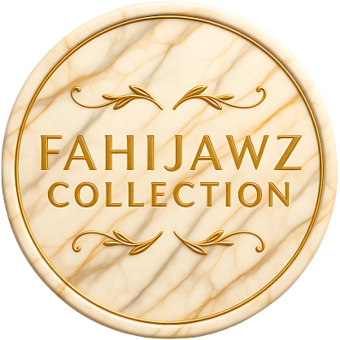

<div align="center">
  

  # ✨ FahiJawz Collection ✨
  
  *Where Tradition Meets Trend.*

  []()
  []()
  []()
  []()

  **FahiJawz Collection is an exclusive digital storefront celebrating Bengali heritage craftsmanship fused with modern elegance. We offer exquisite handcrafted creations—from intricate Crochet wear to timeless Jamdani—tailored for contemporary lifestyles.**
</div>

---

## 🌟 Key Highlights

- 🧶 **Authentic Handcrafted Heritage:** Pure artisanal craftsmanship celebrating traditional Jamdani and crochet artistry.
- 🏛️ **Ultra-Luxury Light Aesthetics:** Bespoke light marble and imperial gold aesthetic with delicate concentric hairline rings, Roman serif typography, and rich visual hierarchy.
- 📜 **Bilingual Store Policies:** Comprehensive 7-point Terms & Conditions and 4-point General Conditions modal with Bengali and English text.
- 📱 **Fully Responsive Layout:** Flawless experience optimized across smartphones, tablets, laptops, and ultra-wide displays.
- 🔒 **Client-Side Content Protection:** Right-click prevention, keyboard shortcut protection, and dynamic focus-loss protection.
- ⚡ **Zero-Dependency Architecture:** Pure semantic HTML5, modern CSS3 variables/animations, and lightweight Vanilla JavaScript.

## 🛠️ Technology Stack

- **Markup & Structure:** Semantic HTML5
- **Styling:** Custom CSS3 (CSS Variables, Flexbox/Grid, Glassmorphism, Micro-animations)
- **Typography:** Google Fonts (`Cinzel`, `Playfair Display`, `Plus Jakarta Sans`, `Hind Siliguri`)
- **Logic & Security:** Pure Vanilla JavaScript (Dynamic copyright calculation, policy modal controller, interactive security guards)

## 🚀 Live Website

Experience the official FahiJawz Collection live:
👉 [**Visit FahiJawz Collection Official Page**](https://remoteruler.github.io/FahiJawz-Collection/)

## 📁 Repository Structure

```text
FahiJawz-Collection/
├── .github/
│   └── workflows/
│       └── static.yml    # GitHub Actions workflow for automatic Pages deployment
├── .gitignore            # Clean git ignore definitions
├── index.html            # Main landing page with bilingual policy modal and protections
├── logo.png              # Official circular marble & imperial gold brand medallion
├── README.md             # Project documentation & overview
└── LICENSE               # Proprietary legal agreement
```

## ⚖️ Legal Information & Copyright

**Copyright © FahiJawz Collection. All rights reserved.**

This repository and its entire contents (including all photos, videos, source code, designs, and descriptions) are the exclusive intellectual property of **FahiJawz Collection**.

⚠️ **UNAUTHORIZED USE IS STRICTLY PROHIBITED** ⚠️

- You may not copy, clone, scrape, or distribute this repository or any part of it.
- Commercial or personal reuse of our designs, branding, or assets is strictly forbidden.
- Please refer to the [**LICENSE**](./LICENSE) file and the **Privacy & Store Policies** modal on the live website for full legal guidelines.

---

<div align="center">
  <i>Crafted with Heritage &amp; Elegance • FahiJawz Collection</i>
</div>
